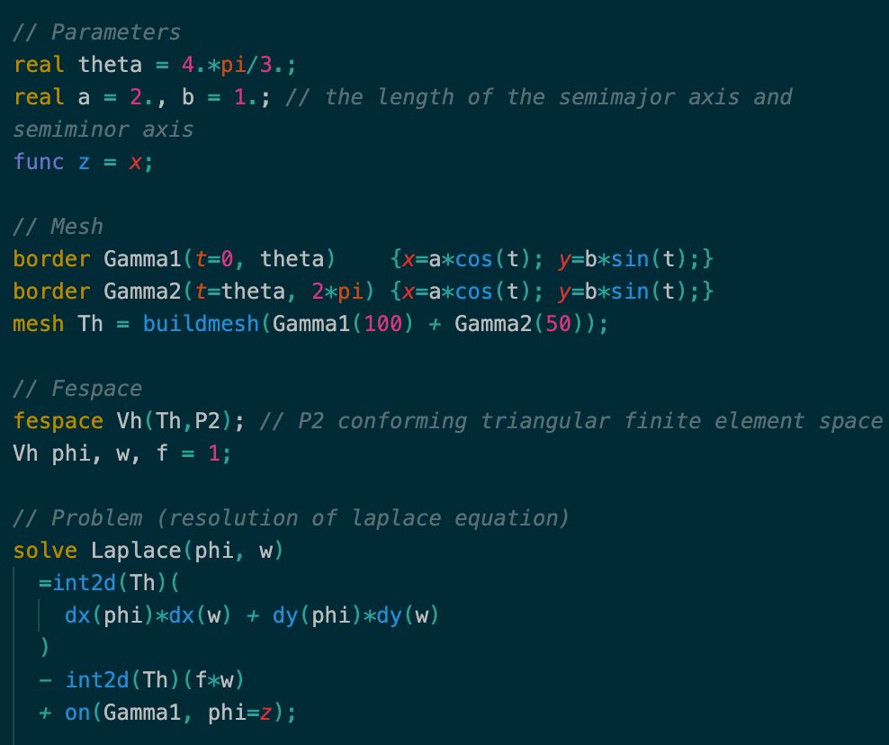
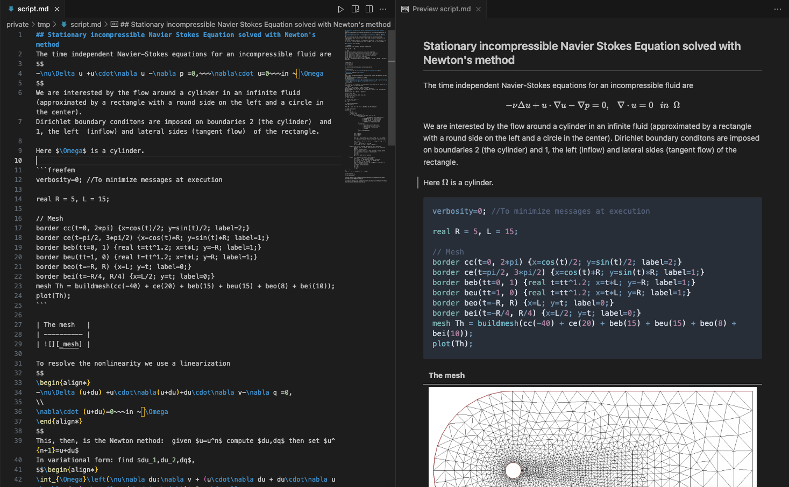

# FreeFEM language for VSCode

## Features

- Syntax highlighting for [FreeFEM](https://freefem.org)

<p align="center" width="100%">
    
</p>

- A command to run current FreeFEM file, accessible via command palette, editor menu or key binding `shift+cmd+r`. It parses the current file for number of MPI processes and parameters.

    Example for using `-wg -ns` flags and 4 MPI processes:

    ```c++
    // NBPROC 4
    // PARAM -wg -ns
    ```

- A debugger: breakpoints in the gutter, stepping, call stack, variables and a Debug Console that runs FreeFEM statements on the live state. Press `F5` on a `.edp` file, or use the *Debug current FreeFEM file* button in the editor title bar. It needs a FreeFEM built with the debugger support (the `debugger` branch of [FreeFem-sources](https://github.com/FreeFem/FreeFem-sources/tree/debugger)), see [docs/debugger.md](docs/debugger.md).

- Syntax highlighting for markdown preview.

<p align="center" width="100%">
    
</p>

## Release Notes

See [CHANGELOG.md](CHANGELOG.md).

## License

MIT
